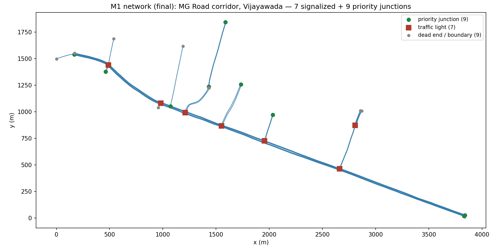

# Vijayawada corridor network

The M1 road network: **MG Road**, Vijayawada, from Benz Circle to PNBS
(Pandit Nehru Bus Station) via Governorpet, plus the real named cross streets
that intersect it. ~4 km, 16 real intersections (7 signal-controlled, 9
priority/give-way), matching the build guide's "9-16 junctions, one arterial"
scope for M1.



## Why this corridor, and why not the whole city

Vijayawada's own police ITMS project is rolling out in phases too — 17
junctions first (Benz Circle among them), 22 more planned after that, not the
whole city at once. That's not a capstone-sized compromise; a real government
deployment with real budget is scoped the same way, for the same reasons this
project is: per-junction calibration (build guide §8.5), simulation
performance at scale, and being able to actually defend correctness per
junction rather than "it works on average across a whole city."

Full-city scale is documented as future work, not attempted here — the
architecture doc's production design (not the Phase-1 slice) already
describes how the platform scales; building that scale is a different,
much larger effort than this capstone's scope.

Source: [Vijayawada intelligent traffic signals at 17 junctions](https://www.deccanchronicle.com/southern-states/andhra-pradesh/vijayawada-to-have-intelligent-traffic-signals-at-17-junctions-within-a-week-1833138)

## How it was built

```bash
export SUMO_HOME=$(python3 -c 'import sumo, os; print(os.path.dirname(sumo.__file__))')
./build.sh
```

That runs three steps (see `build.sh`):

1. **`osmGet.py --bbox 80.6131,16.4972,80.6586,16.5113`** — raw OSM extract
   for a box padded around Benz Circle (16.499725, 80.656067) and PNBS
   (16.5088038, 80.6156014). A straight bbox crop this size also happens to
   trigger a [known netconvert crash](https://github.com/eclipse-sumo/sumo/issues/14917)
   on roads truncated at the box edge — reason #2 (on top of "one arterial
   only") that step 2 exists.
2. **`filter_corridor.py`** — keeps only ways named `MG Road`, any named way
   that actually shares a node with it (the real cross streets: Nakkala Road,
   Pingali Venkaiah Marg, Shivalayam Street, Bandar Road, Eat Street, Museum
   Road, Jammi Chettu Street), and anything touching MG Road's own endpoints.
   Everything else in the bounding box — the surrounding street grid — is
   discarded. This is a straight `bbox` crop's failure mode: it contains
   *every* road in the rectangle, hundreds of junctions, not "one arterial."
3. **`netconvert`** — builds the SUMO network. `--junctions.join` merges the
   OSM-native multi-node intersections (a real crossroads is often 4-8
   separate OSM nodes) into single logical junctions. `--tls.set` forces the
   7 highest-degree (4+ approaches) junctions to be signal-controlled
   regardless of what netconvert infers from this trimmed network alone —
   these are the junctions M2's safety kernel and M4's optimizer actually
   operate on. Everything else stays a realistic priority (give-way)
   junction, same as a real street.

`raw_osm.xml` (the untrimmed download, ~7 MB) is **not** committed — it's
regenerated by step 1 of `build.sh`. `filtered_corridor.osm.xml` (~45 KB) and
`vijayawada_corridor.net.xml` are committed; they're the actual build inputs
everything downstream depends on.

**Reproducing from scratch requires normal internet access** — `osmGet.py`
hits the OSM Overpass API directly, which doesn't work from a
network-restricted CI environment. If you need to regenerate this, run
`build.sh` on a normal machine.

## Junction inventory

| Junction (SUMO id) | Cross street | Type |
|---|---|---|
| `cluster_1880441740_4393296791` | (degree 7 — busiest, near PNBS end) | traffic_light |
| `cluster_1880441532_4393295467_6357870905_6357870906` | Bandar Road | traffic_light |
| `cluster_11608007559_1880441514_4393295460_6354264758` | Pingali Venkaiah Marg | traffic_light |
| `cluster_1880441541_4393295474` | Nakkala Road | traffic_light |
| `7871074777`, `2833253632`, `1880441505` | (degree 4 crossroads) | traffic_light |
| 9 further junctions | Museum Road, Eat Street, Jammi Chettu Street, Shivalayam Street, and minor merges | priority |

Regenerate this table (or verify it) with:

```python
import xml.etree.ElementTree as ET
root = ET.parse("vijayawada_corridor.net.xml").getroot()
for j in root.findall("junction"):
    if j.get("type") not in ("internal",):
        print(j.get("id"), j.get("type"))
```

## The district network (`vijayawada_district.net.xml`)

The corridor above is deliberately one arterial, so between most pairs of
roads there is exactly one way to drive, and the emergency router can't show
a choice. The district network keeps the whole arterial grid around it from
the same OSM extract (trunk down to unclassified roads): **314 roads, every
road reachable from every other, 17 signals** (the corridor's signalised
crossings plus the other crossings where two named arterials meet with at
least three ways in and out). The corridor files and every gate measured on
them are untouched; the district is a separate network for the live console.

Build (needs SUMO, run from this directory):

    PYTHON=python bash build_district.sh /path/to/vijayawada_corridor_bbox.osm.xml

`filter_district.py` keeps the drivable arterial ways. `select_district.py`
keeps the largest strongly connected set of roads, picks the signalised
crossings and, at the end, `--verify` fails the build unless every road
reaches every other. `export_geojson.py NET OUT` writes the console's compact
map geometry, `vijayawada_district.geojson`.

Two things netconvert does on the district but never on the corridor, which
the Tier-0 extractor now handles (both are checked link by link against
sumolib in `tests/control/strategies/test_tier0_extraction.py`):

- a joined cluster whose signal numbers its links in a different order from
  the junction's own conflict table: the conflict matrix is translated into
  the signal's numbering;
- transition phases that keep one movement green (`yyyrrrGyy`): they are
  transitions, not ring phases.

Running it live: `SIM_MODE=live SIM_NETWORK=district` for sim-service, with
demand from `../../demand/vijayawada/build_district.sh`, and the console
built or served with `VITE_ITMS_NETWORK=district` (see
`web-app/network.config.ts`). The backend and the console must use the same
network, since road ids come from the network file.
